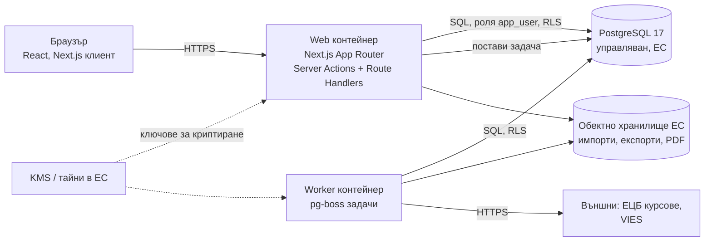

# Архитектура

Версия 0.1 (Фаза 0). Решенията и мотивите им са в `docs/adr/`. Тук е общата картина.

## 1. Обща схема



- **Един език, едно хранилище:** TypeScript strict. Монорепо с pnpm workspaces.
- **Два процеса от един и същ код:** `web` (Next.js) и `worker` (pg-boss). Мащабират се
  отделно.
- **PostgreSQL е центърът:** данни, опашка за задачи, RLS, ограничения за целостта,
  одитен журнал.

## 2. Структура на хранилището (планирана)

```
apps/
  web/            Next.js: страници, server actions, UI
  worker/         фонови задачи (импорти, файлове за НАП, курсове, PDF)
packages/
  domain/         чиста бизнес логика: осчетоводяване, ДДС, амортизации, заплати,
                  закръгляне, превалутиране. Без зависимост от UI и база. Unit тестове.
  db/             Drizzle схема (типове), заявки, връзка с транзакция + RLS контекст
  legal/          генератори и валидатори на файлове (НАП, SAF-T), XSD-та
  ui/             дизайн система: токени, примитиви, таблица, командна палитра
  config/         eslint, tsconfig, prettier
db/migrations/    SQL миграции (up/down), dbmate
docs/             документация, ADR, legal, runbooks
tests/e2e/        Playwright
```

## 3. Многонаемност и изолация (ADR-0002)

- Една база, обща схема. Всяка таблица с данни носи `office_id`, а всяка фирмена таблица
  и `company_id`.
- **RLS на всяка таблица** (`ENABLE` + `FORCE ROW LEVEL SECURITY`). Приложението се свързва
  с роля `app_user`, която не е собственик на таблиците и няма `BYPASSRLS`.
- Всяка заявка минава през `withTenant(ctx, fn)`. Тази функция отваря транзакция и прави
  `SET LOCAL app.user_id`, `app.office_id` и `app.company_id`. Политиките сравняват
  колоните с тези настройки и проверяват `company_access` за потребителя.
- Втора защита в приложния слой: всяко действие проверява правата на ролята (`can(user, action, resource)`).
- **Задължителни тестове за изолация в CI:** за всяка таблица автоматично се генерира тест,
  който опитва SELECT, INSERT, UPDATE и DELETE на чужд ред от името на друга кантора и
  друга фирма. Нова таблица без RLS политика проваля CI (проверка в `pg_class` / `pg_policies`).

## 4. Счетоводна цялост в базата (ADR-0004)

- Сумите са `numeric(19,2)`, количествата `numeric(19,4)`, курсовете `numeric(19,10)`.
  В JS сумите се пренасят като низове и се смятат с `decimal.js`. `number` е забранен за
  пари (ESLint правило).
- **Дт = Кт:** `CONSTRAINT TRIGGER ... DEFERRABLE INITIALLY DEFERRED` върху `journal_line`.
  При commit проверява, че сборът на дебита е равен на сбора на кредита за всяка
  засегната статия (в отчетната валута на годината).
- **Заключен период:** `BEFORE INSERT/UPDATE/DELETE` тригер върху всички таблици, които
  засягат период. Отказва промяната, ако периодът е заключен. Важи за всички роли,
  включително worker-а и импортите.
- **Без безследно изтриване:** осчетоводените статии нямат DELETE (отнето право и тригер).
  Корекцията става със сторно или с нова версия; старата остава в `audit_log`.
- **Одитен журнал:** общ тригер записва в `audit_log` (append-only: без UPDATE/DELETE за
  всички роли, хеш-верига за откриване на подмяна). Записва кой, кога, IP, таблица, ключ,
  старите и новите стойности. Криптираните полета се пазят само в криптиран вид.

## 5. Евро и лев (ADR-0004)

- Всяка `fiscal_year` има `ledger_currency`: BGN за годините до 2025 включително, EUR от
  2026 г. Сумите в статиите са в отчетната валута на годината плюс валутата на документа.
- Преходът 31.12.2025 → 01.01.2026 е едно действие „превалутиране на салдата“. Изпълнява
  се по ЗВЕРБ, чл. 12–13 (деление на 1,95583, закръгляне до 2 знака по третия знак).
  Разликите от закръглянето се осчетоводяват по правилото, което ще потвърдим в
  `docs/legal/euro/` и с пилота.
- Справките за години в BGN се показват в BGN. По желание има изглед „в EUR“ (превалутиране
  при показване), ясно отбелязан като такъв.
- Курсове: ЕЦБ за периодите от 2026 г.; исторически курсове на БНБ за периодите до 2025 г.
  Курсовете се зареждат с фонова задача и не се въвеждат ръчно (освен с одит).

## 6. Сигурност (ADR-0005, ADR-0007)

- Вход: имейл + парола (Argon2id), задължителна TOTP 2FA с кодове за възстановяване.
  Сесиите са в базата (списък и прекратяване). Ограничение на опитите по IP и по акаунт.
  Сесийните бисквитки са HttpOnly, Secure и SameSite=Lax. CSRF защитата е вградена в
  Server Actions.
- Криптиране на поле (ЕГН, IBAN, заплати): AES-256-GCM в приложението, с ключ за всяка
  кантора, обвит от главен ключ в KMS в ЕС (envelope encryption). За търсене по ЕГН се
  пази HMAC „сляп индекс“.
- Логове: структурирани (pino) с филтър, който премахва полетата от списък (ЕГН, IBAN,
  суми на заплати, пароли, токени). Тест проверява, че такива стойности не стигат до лога.
- Заглавия: CSP, HSTS, X-Frame-Options DENY, Referrer-Policy.
- Зависимостите се сканират в CI (npm audit / osv-scanner) и се обновяват с Renovate.

## 7. Фонови задачи (ADR-0006)

pg-boss в същата PostgreSQL. Задачите (импорти, генериране на файлове за НАП и SAF-T,
изтегляне на курсове, PDF) работят през същия `withTenant` контекст, затова RLS и
заключването на период важат и за тях. Задачите са идемпотентни и с ограничен брой опити.

## 8. Файлове за държавни институции

- Генераторите са чисти функции в `packages/legal`: входни данни → низ/байтове.
- XML (SAF-T) се валидира срещу официалния XSD с `xmllint-wasm` (без native модули).
- TXT файловете за ДДС се валидират с наши правила, изведени дума по дума от
  официалното описание, и със златни тестове срещу реално подадени файлове.
- Кодирането на символите (напр. windows-1251 за TXT, UTF-8 за XML) е по спецификацията,
  не по предположение.

## 9. Отчети, PDF и Excel

- PDF: HTML шаблони, отпечатани с headless Chromium (Playwright) в worker-а. Един
  шаблон за екран и печат.
- Excel: `exceljs`. Експортира се точно това, което таблицата показва (колони, филтри, ред).

## 10. Производителност и мащаб

- Индекси: `journal_line (company_id, account_id, period_id)`, `(company_id, counterparty_id)`.
- Агрегати за оборотната ведомост: таблица `account_period_balance`, поддържана от
  тригер в същата транзакция (не асинхронно), за да е винаги равна на статиите. Тест за
  равенство след всеки голям тест-сценарий.
- Партициониране на `journal_line` по `office_id` (hash) се отлага до теста за
  натоварване във Фаза 9. Схемата е съвместима с него (`office_id` е във всеки PK).
- Таблиците в UI: сървърно страниране по ключ (keyset) + виртуализация (TanStack Virtual).

## 11. Среди и деплой (ADR-0009)

- Локално: Docker Compose (PostgreSQL 17, MinIO за обектното хранилище, Mailpit за имейли).
  `pnpm dev` пуска всичко, `pnpm db:seed` зарежда демо данни.
- CI (GitHub Actions): lint, typecheck, unit, integration (истински PostgreSQL в
  контейнер), тестове за изолация, e2e (Playwright), проверка на контраста.
- Среди: `staging` и `production`, и двете в ЕС. Деплой от `main` в staging автоматично;
  в production ръчно с одобрение.
- Резервни копия: PITR на управлявания PostgreSQL + ежедневен логически dump в отделен
  акаунт/регион в ЕС. Възстановяването се репетира (`docs/runbooks/restore.md`, Фаза 1 и 9).
