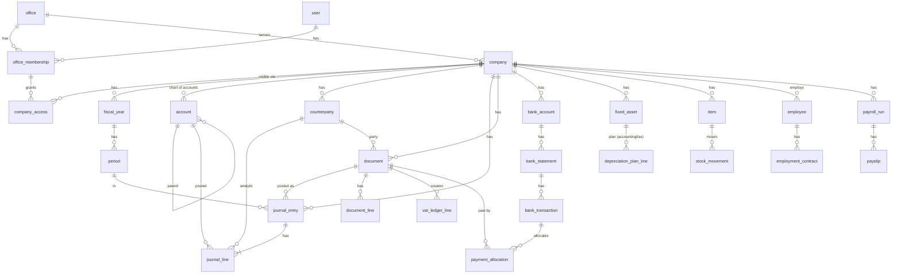

# Модел на данните

Версия 0.1 (Фаза 0), 2026-11-14. Имената са на английски (виж `glossary.md`).
Общи правила за всички таблици:
- `office_id` е във всяка таблица с данни; `company_id` във всяка фирмена таблица. И двете
  участват в съставните чужди ключове, за да не може ред да сочи към друга фирма.
- RLS на всяка таблица (ADR-0002). Одитен тригер на всяка бизнес таблица (ADR-0008).
- Първични ключове: UUID v7 (подредени по време, добри за индекси).
- Пари `numeric(19,2)`, количества `numeric(19,4)`, курсове `numeric(19,10)` (ADR-0004).
- Всички стойности по закон (ставки, прагове, МРЗ, норми) са в `legal_parameter` с
  `valid_from`/`valid_to` и източник, никога в кода.
- Криптираните полета са с префикс `enc_` (ADR-0007).

## 1. Диаграма (ядро)

## 2. Основа (Фаза 1)

| Таблица | Ключови полета | Бележки |
|---------|----------------|---------|
| `office` | id, name, eik, subscription_status, subscription_until | Наемател |
| `user` | id, email, password_hash, totp_secret (enc), totp_enabled_at | Глобален; един човек може да е в няколко кантори |
| `session` | id, user_id, office_id, ip, user_agent, expires_at | |
| `office_membership` | office_id, user_id, role (`owner`/`chief_accountant`/`accountant`/`payroll`/`read_only`) | |
| `company_access` | office_id, user_id, company_id | Кои фирми вижда потребителят |
| `company` | office_id, id, name, eik, vat_number, legal_form, reporting_framework (`nas`/`ifrs`), is_vat_registered, address, saft_enterprise_size, saft_obligation_from | |
| `legal_parameter` | key, value (numeric/jsonb), valid_from, valid_to, source_url, source_ref, verified_at | Глобална таблица (не е по кантора), само четене за `app_user` |
| `audit_log` | office_id, company_id, user_id, ip, at, table_name, row_pk, action, old, new, prev_hash, hash | Append-only, партиции по месец |
| `user_preference` | user_id, theme (`system`/`light`/`dark`/`black`), shortcuts | |

## 3. Счетоводно ядро (Фаза 2)

| Таблица | Ключови полета | Бележки |
|---------|----------------|---------|
| `currency` | code (ISO 4217), name, minor_units | Глобална |
| `exchange_rate` | currency, rate_date, rate, source (`ecb`/`bnb`/`fixed_eur_bgn`), base | Глобална |
| `unit_of_measure` | office_id, company_id, code, name, saft_uom_code | SAF-T UOMTable |
| `fiscal_year` | company_id, id, year, start_date, end_date, ledger_currency (`BGN`/`EUR`), status | |
| `period` | company_id, fiscal_year_id, id, month, start_date, end_date, locked_at, locked_by | Заключване |
| `account` | company_id, id, code, name, parent_id, type (актив/пасив/…), is_postable, analytic_flags (counterparty/document/cost_object/quantity), currency_tracking, **saft_account_code**, **saft_account_type** | Сметкопланът е данни |
| `chart_template` | id, name, version, source | Шаблон (напр. примерен национален сметкоплан) |
| `cost_object` | company_id, id, code, name | Обекти/места на разход |
| `counterparty` | company_id, id, name, eik, vat_number, country, address, is_individual, enc_egn, enc_iban, vies_checked_at, vies_result, **saft_customer_id/supplier_id** | |
| `journal_entry` | company_id, id, period_id, number, entry_date, description, source_type, source_id, status (`draft`/`posted`/`reversed`), reverses_entry_id, version | |
| `journal_line` | company_id, entry_id, line_no, account_id, side (`D`/`C`), amount (отчетна валута), doc_currency, doc_amount, fx_rate, counterparty_id, document_ref, cost_object_id, quantity, uom | Дт=Кт: отложен тригер |
| `account_period_balance` | company_id, account_id, period_id, analytic key, opening, debit, credit, closing | Поддържа се в транзакцията |
| `entry_template` | company_id, id, name, lines (jsonb с формули) | Шаблони |
| `fx_revaluation_run` | company_id, period_id, rate_date, created_entry_id | |
| `euro_conversion_run` | company_id, from_year_id, to_year_id, method, rounding_diff_account_id, entry_id | Превалутиране 2025 → 2026 |
| `import_job` | office_id, company_id, kind, status, file_key, preview (jsonb), errors (jsonb) | |

## 4. ДДС (Фаза 3)

| Таблица | Ключови полета | Бележки |
|---------|----------------|---------|
| `document` | company_id, id, kind (`invoice`/`debit_note`/`credit_note`/`self_charge_protocol`/…), direction (`purchase`/`sale`), number, issue_date, tax_event_date, counterparty_id, currency, totals, related_document_id, period_id | Номерацията и видовете документи се вземат от спецификацията на НАП |
| `document_line` | document_id, line_no, description, item_id, quantity, uom, unit_price, net_amount, vat_rate_code, vat_amount, account_id | |
| `vat_ledger_line` | company_id, period_id, ledger (`purchases`/`sales`), document_id, column_code, amount | Колоните са по официалното описание; кодовете не се измислят |
| `vat_return` | company_id, period_id, status, cells (jsonb по официалния номер на клетката), generated_files | |
| `vies_declaration` | company_id, period_id, lines | |
| `tax_code` | company_id, code, description, rate_param_key, **saft_tax_code** | SAF-T TaxTable |

## 5. Банка и каса (Фаза 4)

| Таблица | Ключови полета |
|---------|----------------|
| `bank_account` | company_id, id, enc_iban, iban_last4, bank_code, currency, account_id |
| `bank_statement` | company_id, bank_account_id, format (`mt940`/`camt053`/`csv_*`), period, opening, closing, file_key |
| `bank_transaction` | statement_id, booking_date, value_date, amount, currency, counterparty_name, enc_counterparty_iban, reference, status |
| `payment_allocation` | bank_transaction_id или cash_order_id, document_id, amount, match_score, confirmed_by |
| `cash_order` | company_id, kind (`receipt`/`payment`), number, date, amount, counterparty_id, entry_id |

## 6. ДМА (Фаза 5)

| Таблица | Ключови полета |
|---------|----------------|
| `fixed_asset` | company_id, id, inventory_no, name, category, acquisition_date, put_in_use_date, cost, account_id, disposal_date, **saft_asset fields** |
| `depreciation_plan` | asset_id, kind (`accounting`/`tax`), method, rate или useful_life, tax_category (от `legal_parameter`), start_period |
| `depreciation_plan_line` | plan_id, period_id, amount, accumulated, book_value, posted_entry_id |
| `asset_transaction` | asset_id, kind (придобиване/преоценка/отписване/…), date, amount — за SAF-T AssetTransactions |

## 7. Минимален склад (за SAF-T при поискване)

| Таблица | Ключови полета |
|---------|----------------|
| `item` | company_id, id, code, name, uom, kind (стока/материал/продукт), account_id, **saft_product fields** |
| `warehouse` | company_id, id, code, name |
| `stock_movement` | company_id, id, date, item_id, warehouse_id, direction, quantity, value, document_id, movement_type |
| `stock_balance` | company_id, item_id, warehouse_id, period_id, opening_qty/value, closing_qty/value |

Не е пълна складова програма: няма поръчки, резервации, партиди, производство.

## 8. ТРЗ (Фаза 7)

| Таблица | Ключови полета |
|---------|----------------|
| `employee` | company_id, id, enc_egn, egn_hash (сляп индекс), name, enc_address, enc_iban |
| `employment_contract` | employee_id, kind (`labor`/`civil`), start_date, end_date, position_code, enc_base_salary, working_hours, insurance_type |
| `leave` / `sick_leave` | employee_id, kind, from, to, days, document_no |
| `payroll_run` | company_id, period_id, status, entry_id |
| `payslip` | run_id, employee_id, enc_lines (jsonb: начисления, удръжки, осигуровки) |
| `form1_record` / `form6_record` | company_id, period_id, employee_id, data (по официалния формат) |
| `art62_notification` | company_id, employee_id, kind, data, file_key |

Всички ставки, МРЗ, максимален осигурителен доход и т.н. са в `legal_parameter`.

## 9. Годишно приключване (Фаза 6)

| Таблица | Ключови полета |
|---------|----------------|
| `closing_run` | company_id, fiscal_year_id, kind (`pl_close`/`carry_forward`), entry_id |
| `fs_template` | framework (`nas`/`ifrs`), statement (`balance_sheet`/`income_statement`), version, rows (код на ред → сметки) |
| `fs_report` | company_id, fiscal_year_id, template_id, values |

## 10. Проверка срещу SAF-T

Действащата схема е V_1.0.3 (Заповед З-ЦУ-30-1797/13.10.2026). **Самият XSD още не е в
`docs/legal/saf-t/`**, затова проверката е само на ниво структура (OECD SAF-T 2.0, на
която се базира българската версия). Проверката поле по поле се прави, щом собственикът
изтегли XSD-то, и резултатът се записва тук.

| Част на SAF-T | Откъде идват данните | Какво трябва да има моделът още сега |
|---------------|----------------------|--------------------------------------|
| Header | `company`, `office` | ЕИК, адрес, период, валута, вид на файла |
| MasterFiles: GeneralLedgerAccounts | `account` | **Код по номенклатурата на НАП за сметки** + вид сметка (`saft_account_code`) |
| MasterFiles: Customers / Suppliers | `counterparty` | Идентификатор, ЕИК/ДДС номер, адрес, салда |
| MasterFiles: TaxTable | `tax_code` | **Данъчни кодове по номенклатурата на НАП** |
| MasterFiles: UOMTable | `unit_of_measure` | Код на мерната единица по номенклатурата |
| MasterFiles: Products | `item` | Код, наименование, мерна единица |
| MasterFiles: PhysicalStock | `stock_balance` | Количества и стойности (при поискване) |
| MasterFiles: Assets | `fixed_asset`, `depreciation_plan` | Данни за счетоводна и данъчна амортизация (годишен файл) |
| GeneralLedgerEntries | `journal_entry`, `journal_line` | Сметка, контрагент, документ, валута, сума в местна и чужда валута |
| SourceDocuments: SalesInvoices / PurchaseInvoices | `document`, `document_line` | Редове, ДДС, мерни единици, връзка към статията |
| SourceDocuments: Payments | `bank_transaction`, `cash_order`, `payment_allocation` | Връзка плащане ↔ документ |
| SourceDocuments: MovementOfGoods | `stock_movement` | Вид движение, количество, склад |
| SourceDocuments: AssetTransactions | `asset_transaction` | Вид операция с актива |

**Изводи за модела:**
- Кодът на сметката по SAF-T и данъчните кодове са колони от Фаза 2, а не допълнение във
  Фаза 8.
- Номенклатурите на НАП (сметки, данъчни кодове, мерни единици, видове движения) влизат
  като глобални справочни таблици с версия, заредени от официалните файлове.
- Всеки ред на статия трябва да може да се свърже с документа-източник, иначе разделът
  SourceDocuments не се генерира.
- Кодът по SAF-T се пази върху сметката, а не се изчислява при генерирането. Така
  счетоводителят може да го види и поправи.
